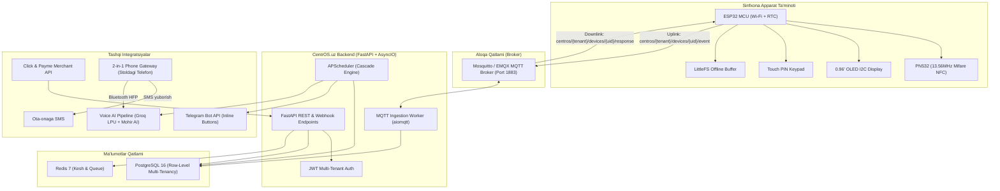
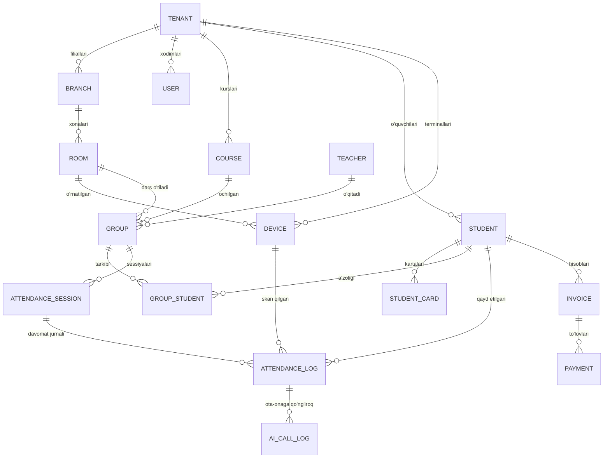
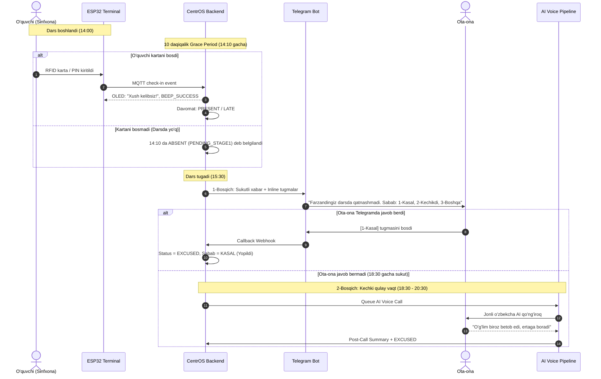

# CentrOS.uz — Multi-Tenant Database & Backend Core Arxitekturasi

Bu hujjat **CentrOS.uz** (AI-First Autonomous CRM/ERP) platformasining markaziy ma'lumotlar bazasi, ko'p ijarachili (Multi-Tenant) arxitekturasi, ESP32 IoT xona terminallari bilan MQTT protokoli va kaskadli davomat konveyeri bo'yicha to'liq texnik qo'llanmani taqdim etadi.

---

## 1. Tizim Arxitekturasi va Dasturiy Stack



---

## 2. Relyatsion Ma'lumotlar Bazasi Sxemasi (ER Diagram)

Platforma har bir o'quv markazining ma'lumotlarini qat'iy ajratuvchi **Row-Level Tenant Scoping** (`tenant_id` xorijiy kaliti va indeksi) tamoyiliga asoslangan.



---

## 3. IoT Terminal (ESP32) va Server O'rtasidagi MQTT Protokoli

Xona terminali va server o'rtasida ma'lumotlar almashinuvi **~50-100 ms** tezlikda MQTT orqali yengil JSON paketlar ko'rinishida amalga oshiriladi.

### A. Uplink (Terminaldan Serverga)
* **Mavzu (Topic):** `centros/{tenant_slug}/devices/{device_uid}/event`
* **JSON namunasi:**
```json
{
  "device_uid": "CENTROS-ESP-B4E62D",
  "rfid_uid": "4A12B89C",
  "pin": null,
  "timestamp": 1730419200,
  "offline_sync": false,
  "battery_level": 95,
  "wifi_rssi": -54
}
```

### B. Downlink (Serverdan Terminalga)
* **Mavzu (Topic):** `centros/{tenant_slug}/devices/{device_uid}/response`
* **Muvaffaqiyatli darsga kirish (Normal check-in):**
```json
{
  "status": "SUCCESS",
  "student_name": "Azizbek R.",
  "group_name": "IELTS Intensive",
  "message": "Xush kelibsiz!",
  "buzzer_tone": "BEEP_SUCCESS",
  "soft_block": false,
  "balance": 150000.0
}
```

* **Moliyaviy Soft-Block (Qarzdorlik holatida):**
```json
{
  "status": "SOFT_BLOCK",
  "student_name": "Jasur A.",
  "message": "Qarzdorlik! Ma'muriyatga!",
  "buzzer_tone": "BEEP_ALERT",
  "soft_block": true,
  "balance": -150000.0
}
```

---

## 4. Kaskadli Davomat Mexanizmi (Cascade Lifecycle)



---

## 5. Loyiha Fayllar Strukturasi

* [**`backend/`**](file:///e:/CentrOS.uz/backend) — FastAPI + SQLAlchemy 2.0 Multi-Tenant Backend Core:
  * [`app/main.py`](file:///e:/CentrOS.uz/backend/app/main.py) — Kirish nuqtasi, MQTT broker ulanishi, kaskadli scheduler va React Frontendni bevosita tarqatish (`StaticFiles`).
  * [`app/models/`](file:///e:/CentrOS.uz/backend/app/models) — Relyatsion sxema: markazlar, filiallar, xonalar, qurilmalar, o'quvchilar, davomat va to'lovlar.
  * [`app/services/attendance_service.py`](file:///e:/CentrOS.uz/backend/app/services/attendance_service.py) — 100 ms kechikishdagi IoT davomat drayveri va moliyaviy Soft-Block.
  * [`app/services/cascade_service.py`](file:///e:/CentrOS.uz/backend/app/services/cascade_service.py) — 3 bosqichli kaskadli ota-onalar aloqasi (Grace period, dars tugagach sukutli SMS/Telegram, kechki AI qo'ng'iroq).
* [**`firmware/`**](file:///e:/CentrOS.uz/firmware) — Sinfxona eshik terminali mikrodasturi (ESP32 DevKit + PN532 Mifare + 0.96" OLED + MAX98357A I2S Audio Dinamik):
  * Klaviaturasiz ixcham korpus, $14-$17 tannarx, LittleFS oflayn kesh, o'zbekcha audio xabarlar.
* [**`voice_agent/`**](file:///e:/CentrOS.uz/voice_agent) — 2-in-1 Telefon Shlyuzi, Groq LPU (Llama 3.3 70B) va Mohir AI Ovozli AI Konveyeri:
  * `phone_bridge.py` — Stoldagi bitta telefon orqali bepul SMS va Bluetooth HFP orqali GSM qo'ng'iroq.
  * `vad.py` — 20 ms freymli VAD va Barge-In (inson gap boshlaganda robotni to'xtatish).
  * `post_call_analytics.py` — Churn xavfini aniqlash va direktorga tezkor Telegram Alert jo'natish.
* [**`frontend/`**](file:///e:/CentrOS.uz/frontend) — React + Vite + TypeScript + Tailwind CSS CRM Paneli va Telegram Mini App:
  * `src/components/TeacherView.tsx` — O'qituvchilar uchun darsda kartasini unutgan o'quvchini 1 bosishda darsda deb belgilash ("Kartasiz darsda").
  * `src/components/DashboardView.tsx` — Direktor uchun BI KPIlar, Churn signallari va sinfxona terminallari monitoringi.
  * `src/components/AICallsView.tsx` — Groq LLM suhbat tahlillari va transkriptlar.
  * `src/components/TelegramMiniAppView.tsx` — Ota-onalar uchun Telegram ichidagi ilova (Davomat, sabab yuborish, Click/Payme to'lov).
  * `src/components/FinanceView.tsx` — Oylik to'lovlar va qarzdorlar nazorati.
* [**`telegram_bot/`**](file:///e:/CentrOS.uz/telegram_bot) — Telegram Bot, Webhook va Polling xizmati:
  * `bot_service.py` — Ota-onalarga dars qoldirilganda inline tugmali xabar yuborish, sababni belgilash (`1-Kasal`, `2-Yo'lda`), o'qituvchilar uchun `/dars` komandasi orqali kartasiz kelgan o'quvchini darsda deb belgilash.
  * `run_polling.py` — Mahalliy kompyuterda domensiz botni to'g'ridan-to'g'ri sinash uchun Long-Polling drayveri.
* [**`start_centros.bat`**](file:///e:/CentrOS.uz/start_centros.bat) — Barcha xizmatlarni (FastAPI + MQTT + React CRM) bitta bosishda ishga tushiruvchi start fayl.
